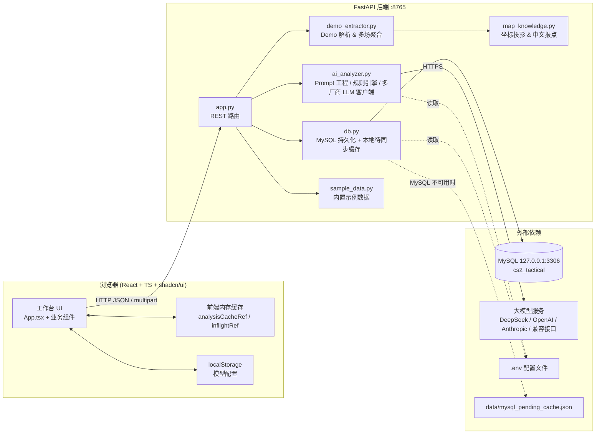
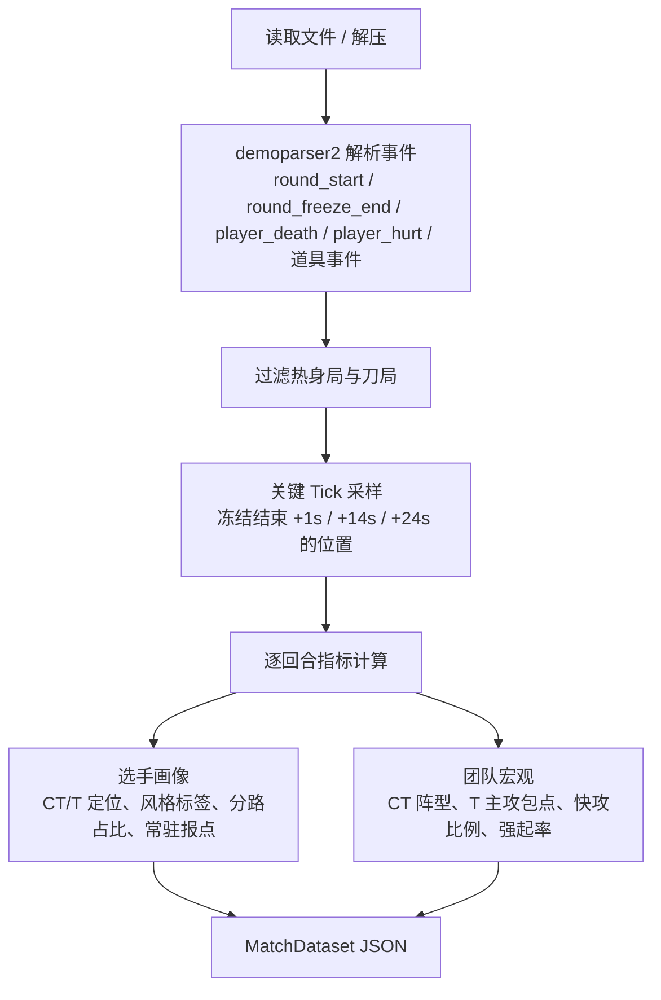
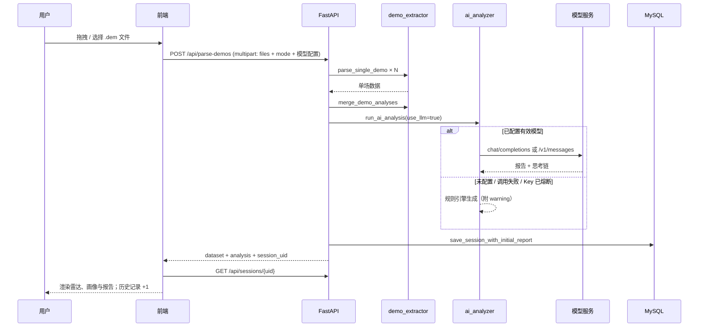
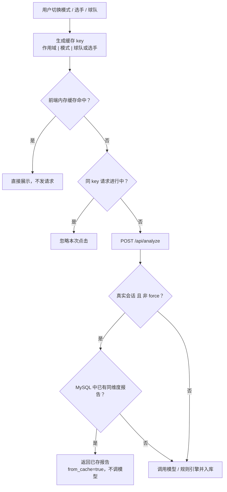
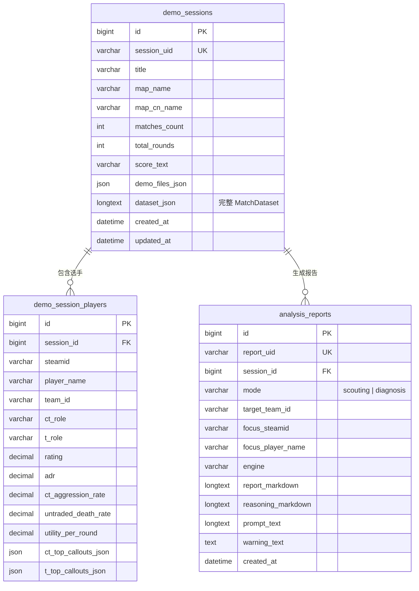
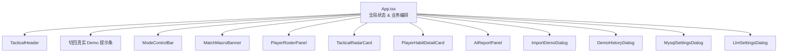

# ARCHITECTURE.md — CS2 完美平台 Demo 战术习惯 & Anti-Strat AI 分析系统

> 文档版本：v0.3（对应后端 `FastAPI app version 0.3.0`）
> 更新时间：2026-11-15
> 相关文档：[README.md](./README.md)（快速启动） · [DESIGN.md](./DESIGN.md)（UI 视觉规范）

---

## 1. 项目概述

### 1.1 背景

完美世界竞技平台（PWA）的玩家和车队需要知道两件事：对手在某张地图上**习惯怎么打**，自己在某张地图上**有哪些坏习惯**。本系统不依赖平台的实时对局接口，直接用平台导出的 **CS2 `.dem` 录像文件**作为数据源。系统先把录像解析成结构化的空间遥测数据，再交给大模型（或内置规则引擎）生成战术报告。

### 1.2 两种分析模式

| 模式 | 标识 | 输入 | 输出 |
| :--- | :--- | :--- | :--- |
| 方案一：赛前对手球探 | `scouting` | 对手 1～N 场同地图 Demo | 对手 5 人的地图习惯画像 + 针对性 Anti-Strat 战术简报 |
| 方案二：个人 / 车队诊断 | `diagnosis` | 自己本场或多场 Demo | 指定选手的坏习惯 TOP3 + 车队协同漏洞 + 改进清单 |

### 1.3 设计目标

- **离线可用**：没配置大模型时，内置规则引擎也能根据真实解析数据生成报告。
- **多厂商模型**：支持 DeepSeek / OpenAI / Anthropic / 任意 OpenAI 兼容接口。
- **结果可追溯**：上传的 Demo 遥测数据和每份 AI 报告都持久化到 MySQL，可随时切回查看。
- **控制调用成本**：内置示例不调用模型；同一维度已分析过的报告直接复用，不重复调用。

---

## 2. 总体架构



**分层职责：**

| 层 | 职责 | 关键文件 |
| :--- | :--- | :--- |
| 表现层 | 交互、可视化（2D 雷达 / 画像卡片 / 报告）、前端缓存 | `frontend/src/App.tsx`、`frontend/src/components/*` |
| 接口层 | 路由、参数校验、编排解析 → 分析 → 入库 | `backend/app.py` |
| 领域层 | Demo 特征提取、地图知识、Prompt 与规则引擎 | `backend/demo_extractor.py`、`backend/map_knowledge.py`、`backend/ai_analyzer.py` |
| 基础设施层 | MySQL 持久化、LLM HTTP 客户端、配置读写 | `backend/db.py`、`backend/ai_analyzer.py`（客户端部分） |

---

## 3. 技术栈

| 类别 | 选型 |
| :--- | :--- |
| 前端 | Vite 6 · React 18 · TypeScript · Tailwind CSS · shadcn/ui（Radix UI）· lucide-react · react-markdown + remark-gfm |
| UI 风格 | Uiverse Design「Dark Structural Telemetry」，见 `frontend/src/styles/uiverse-system.css` |
| 后端 | Python 3.13 · FastAPI · Uvicorn · python-multipart |
| Demo 解析 | `demoparser2`（Rust 内核）· pandas |
| HTTP 客户端 | httpx（异步） |
| 数据库 | MySQL（PyMySQL 驱动，utf8mb4） |
| 配置 | python-dotenv（`.env` 热读取 + `set_key` 写回） |
| 包管理 | 后端 `.venv` + pip；前端 pnpm |

---

## 4. 目录结构

```text
game_research/
├── ARCHITECTURE.md            # 本文档
├── DESIGN.md                  # UI 视觉设计规范
├── README.md                  # 快速启动说明
├── .env / .env.example        # MySQL 与模型服务配置（.env 已被 .gitignore 忽略）
├── requirements.txt           # Python 依赖
├── start.sh                   # 一键启动（构建前端 + 启动 uvicorn）
├── cli.py                     # 命令行分析入口
├── data/                      # MySQL 不可用时的本地待同步缓存（运行时生成）
├── backend/
│   ├── app.py                 # FastAPI 路由与编排
│   ├── demo_extractor.py      # Demo 解析、指标计算、多场聚合
│   ├── map_knowledge.py       # 地图雷达投影参数、报点中文化与分区
│   ├── ai_analyzer.py         # Prompt 构建、规则引擎、多厂商 LLM 客户端
│   ├── db.py                  # MySQL 建库建表与 CRUD、本地缓存兜底
│   └── sample_data.py         # 内置示例（Mirage 球探 / Inferno 诊断）
├── tests/
│   └── test_prototype.py      # 端到端集成测试
└── frontend/
    ├── vite.config.ts / tailwind.config.js / components.json
    └── src/
        ├── App.tsx            # 全局状态与业务编排
        ├── api/client.ts      # 后端 API 封装
        ├── types/tactical.ts  # 前后端共享数据结构的 TS 定义
        ├── styles/uiverse-system.css
        └── components/
            ├── TacticalHeader.tsx        # 顶栏：示例切换 / 历史记录 / 导入 / MySQL / 模型配置
            ├── ModeControlBar.tsx        # 模式、目标球队、焦点选手、生成分析
            ├── MatchMacroBanner.tsx      # 地图与团队宏观数据条
            ├── PlayerRosterPanel.tsx     # 选手列表
            ├── TacticalRadarCard.tsx     # 2D 战术雷达（SVG）
            ├── PlayerHabitDetailCard.tsx # 选手量化习惯卡片
            ├── AiReportPanel.tsx         # AI 报告 / Prompt / 思考链 / 已存报告切换
            ├── ImportDemoDialog.tsx      # 拖拽 / 选择文件上传
            ├── DemoHistoryDialog.tsx     # 历史 Demo 记录库
            ├── MysqlSettingsDialog.tsx   # MySQL 连接配置
            ├── LlmSettingsDialog.tsx     # 多厂商模型配置与连通性测试
            └── ui/                       # shadcn/ui 基础组件 + Uiverse 原语
```

---

## 5. 后端模块设计

### 5.1 `map_knowledge.py`：地图知识库

- `world_to_radar_pct(x, y, map_name)`：用 CS2 官方雷达参数（`pos_x`、`pos_y`、`scale`）把 3D 世界坐标投影成 0～100% 的 2D 雷达坐标。
- `resolve_callout(raw_place, map_name)`：把引擎里的 `last_place_name` 映射成中文报点，并归入 `A` / `MID` / `B` / `SPAWN` 四个分区。
- `get_map_meta(map_name)`：返回地图中文名和雷达地标，供前端绘制。

### 5.2 `demo_extractor.py`：Demo 解析与特征提取

**输入**：`.dem` / `.zip` / `.gz` / `.bz2`（压缩包会先安全解压到临时目录）。

**处理流程：**



**核心指标：**

| 指标 | 口径 |
| :--- | :--- |
| Rating / ADR / K/D / HS% / KAST% | 常规战斗数据（Rating 为估算值） |
| 首杀尝试率 / 首杀胜率 | 参与每回合首次交火的比例与胜率 |
| CT 前压率 | 冻结结束后 22 秒内进入前顶争夺区或主动首交火 |
| 白给率（Untraded Death %） | 阵亡后 5 秒内没有队友补枪的比例 |
| 分路占比 / 常驻报点 | 基于 +14s / +24s 采样点归入的分区 |
| 道具习惯 | 回合均烟 / 闪 / 火投掷量、均致盲敌人次数 |
| 团队阵型 | CT 开局 A / 中 / B 人数分布（如 `2A-1中-2B`）占比 |

- `parse_single_demo(path)`：单场解析，返回 `MatchDataset`。
- `merge_demo_analyses(list)`：多场同地图按 `SteamID` 聚合，指标按回合数加权合并。

### 5.3 `ai_analyzer.py`：分析引擎

由三部分组成：

1. **Prompt 构建**：`build_scouting_prompt` / `build_diagnosis_prompt` 把 `MatchDataset` 序列化成结构化中文 Prompt，并规定报告必须包含哪些模块。
2. **规则引擎**：`generate_rule_based_report` 根据阈值（如 CT 前压率 ≥ 35% 且首杀胜率 < 48%、白给率 ≥ 48% 等）动态生成 Markdown 报告，不依赖任何外部服务。
3. **多厂商 LLM 客户端**：见第 8 节。

入口函数 `run_ai_analysis(data, mode, ..., provider, use_llm)` 返回统一结构：

```json
{
  "engine": "llm (deepseek-flash) | rule_engine | rule_engine_fallback",
  "report_markdown": "...",
  "reasoning_markdown": "... (可选，模型思考链)",
  "prompt": "...",
  "warning": "... (可选，降级原因)"
}
```

### 5.4 `db.py`：持久化层

- **自动初始化**：`init_db()` 自动建库 `cs2_tactical` 和三张表，并把本地待同步缓存刷入 MySQL。
- **配置热加载**：每次连接前重新读取 `.env`，修改密码不需要重启服务。
- **降级兜底**：MySQL 连不上时（如未填密码），写入 `data/mysql_pending_cache.json`；之后一旦连通就自动同步，保证上传记录不丢。
- **主要函数**：

| 函数 | 说明 |
| :--- | :--- |
| `save_session_with_initial_report` | 保存新上传的 Demo 会话 + 选手明细 + 首份报告 |
| `save_report_to_existing_session` | 给已有会话追加一份新报告 |
| `find_existing_report` | 按分析维度查找已存报告（用于去重） |
| `list_sessions` / `get_session_detail` / `delete_session` | 历史记录查询、详情、删除（级联删除） |
| `get_db_status` / `update_mysql_config` | 连接状态检查、在线修改配置（验证通过后才写回 `.env`） |

### 5.5 `app.py`：接口编排

- 启动时（`lifespan`）尝试初始化数据库，并在日志中打印连接结果。
- 上传接口完成「保存临时文件 → 解析 → 聚合 → AI 分析 → 入库」的完整编排。
- 开启了 CORS（`allow_origins=["*"]`），方便 Vite 开发服（5173）直接跨域访问 8765。
- 如果存在 `frontend/dist`，会同源托管前端静态资源。

---

## 6. 核心业务流程

### 6.1 上传真实 Demo 并分析



### 6.2 切换模式 / 选手 / 球队（去重）



**会强制重新调用模型的情况（`force=true`）**：手动点击「生成 AI 战术分析」，或保存了新的模型配置。

### 6.3 内置示例

点击「示例一 / 示例二」→ `GET /api/samples/{kind}` → 后端固定 `use_llm=False` 用规则引擎生成假报告。之后在示例内的所有切换都以 `use_llm=false` 调用 `/api/analyze`，**不会调用任何模型服务**，也不会入库。

---

## 7. API 设计

| 方法 | 路径 | 说明 |
| :--- | :--- | :--- |
| GET | `/api/health` | 健康检查 |
| GET | `/api/samples/{kind}` | 加载内置示例（`scouting` / `diagnosis`），只用规则引擎 |
| POST | `/api/parse-demos` | 上传 Demo（multipart），解析 + 分析 + 入库 |
| POST | `/api/parse-local` | 按本机路径解析 Demo（免去大文件上传） |
| POST | `/api/analyze` | 生成分析；支持 `session_uid`、`use_llm`、`force`、`provider` |
| GET | `/api/sessions` | 历史 Demo 列表 |
| GET | `/api/sessions/{session_uid}` | 会话详情（完整数据集 + 全部报告） |
| DELETE | `/api/sessions/{session_uid}` | 删除会话（级联删除报告与选手明细） |
| GET | `/api/db/status` | MySQL 连接状态与统计 |
| POST | `/api/db/config` | 在线配置 MySQL（先验证连接，成功后写回 `.env`） |
| POST | `/api/llm/config` | 保存模型配置到 `.env`，并清除鉴权熔断状态 |
| POST | `/api/llm/test` | 发一条真实探针请求测试模型连通性 |

**`/api/analyze` 请求体示例：**

```json
{
  "data": { "...MatchDataset..." },
  "mode": "diagnosis",
  "target_team_id": "TEAM_A",
  "focus_steamid": "7656119xxxxxxxxxx",
  "session_uid": "sess_20261115_153012_ab12cd",
  "use_llm": true,
  "force": false,
  "provider": "anthropic",
  "base_url": "https://api.anthropic.com",
  "model": "claude-sonnet-5-5",
  "api_key": "sk-ant-...",
  "reasoning_effort": "low"
}
```

---

## 8. 多厂商大模型适配

### 8.1 厂商协议差异

| provider | Endpoint | 鉴权 | 请求体差异 | 返回解析 |
| :--- | :--- | :--- | :--- | :--- |
| `deepseek` | `{base}/chat/completions` | `Authorization: Bearer` | `deepseek-flash` 支持 `thinking` + `reasoning_effort`；别名 `deepseek-v4.1-flash` 自动纠正 | `choices[0].message.content` / `reasoning_content` |
| `openai` | `{base}/chat/completions` | `Authorization: Bearer` | 传 `reasoning_effort`，不传 `temperature`；用 `max_completion_tokens` | 同上 |
| `anthropic` | `{base}/v1/messages` | `x-api-key` + `anthropic-version: 2023-06-01` | `system` 独立字段，必须带 `max_tokens` | `content[]` 中的 `text` 块与 `thinking` 块 |
| `custom` | `{base}/chat/completions` | Bearer（可无） | 标准 OpenAI 兼容；Ollama 地址自动补 `/v1` | 同 OpenAI |

如果请求里没有带 `provider`，会根据 Base URL 自动推断。

### 8.2 配置优先级

`请求参数` > `.env`（`LLM_PROVIDER` / `LLM_BASE_URL` / `LLM_MODEL` / `LLM_API_KEY` / `LLM_REASONING_EFFORT`）> 进程环境变量 > 厂商默认值。

### 8.3 容错机制

| 机制 | 说明 |
| :--- | :--- |
| 自动降级 | 网络异常、超时、4xx/5xx 时改用规则引擎，并在 `warning` 中说明原因 |
| 鉴权熔断 | 同一组「Base URL + Key」返回 401/403 后记入内存，后续请求不再打远端；保存新配置或测试成功后自动解除 |
| 参数兼容重试 | 返回 400 且报错与 `reasoning_effort` / `thinking` / `temperature` 等可选参数有关时，去掉这些参数自动重试一次 |
| 调用判定 | 公有云厂商必须有 Key 才调用；私有/内网地址允许无 Key 调用 |
| 调用日志 | 终端打印 `[LLM-CALL] -> / <- / !!`，方便和模型平台后台的调用记录对账 |

---

## 9. 数据模型

### 9.1 MySQL 表结构（库：`cs2_tactical`，`utf8mb4`）



**设计说明：**

- `dataset_json` 保存完整数据集，用于前端一键还原雷达和画像。`demo_session_players` 冗余存储核心指标，方便直接用 SQL 做跨场次检索，例如「某 SteamID 在所有 Mirage 场次的 CT 前压率」。
- 外键 `ON DELETE CASCADE`：删除会话时自动清理关联的选手和报告。
- `session_uid` / `report_uid` 是业务唯一键，保证从本地缓存同步到 MySQL 时幂等、不重复插入。

### 9.2 `MatchDataset` 核心结构（前后端共享）

```text
MatchDataset
├── source_type, demo_files[], matches_count
├── map_name, map_cn_name, map_landmarks[]
├── total_rounds, score_text
├── teams: { TEAM_A: TeamMacro, TEAM_B: TeamMacro }
│   └── ct_formations[], t_attack_a_pct, t_attack_b_pct, t_fast_execute_pct, team_force_buy_rate
└── players: PlayerProfile[]
    ├── steamid, name, team_id, ct_role, t_role, style_tags[]
    ├── stats: PlayerStats (rating, adr, kast_pct, ct_aggression_rate, untraded_death_rate, ...)
    ├── ct_lanes_pct / t_lanes_pct, ct_top_callouts[] / t_top_callouts[]
    ├── top_weapons[], opening_kill_spots[], opening_death_spots[]
    └── radar_points[] (x, y, side, kind, place, round)
```

TypeScript 定义见 `frontend/src/types/tactical.ts`。

---

## 10. 前端架构

### 10.1 组件结构



### 10.2 状态管理

全部状态集中在 `App.tsx`，用 React Hooks 管理，没有引入额外的状态库：

| 状态 | 说明 |
| :--- | :--- |
| `dataset` / `analysis` | 当前展示的数据集与报告 |
| `activeSample` / `activeSessionUid` | 当前上下文：内置示例 或 真实会话（二者互斥） |
| `savedReports` / `activeReportUid` | 当前会话的已存报告与选中项 |
| `mode` / `targetTeamId` / `selectedSteamId` | 分析维度 |
| `sessions` / `dbStatus` | 历史记录与 MySQL 状态 |
| `llmSettings` | 模型配置（同步到 localStorage 和后端 `.env`） |
| `analysisCacheRef` / `inflightRef` | 报告内存缓存 / 进行中请求集合（`useRef`，不触发重渲染） |

### 10.3 启动流程

1. 如果 localStorage 有模型配置，同步一份到后端 `.env`。
2. 拉取 `/api/db/status` 和 `/api/sessions`。
3. 有历史上传记录时，自动恢复最近一条；否则加载内置示例一。

### 10.4 API 地址

开发环境（页面端口 5173）由浏览器直接请求 `http://{host}:8765`，不走 Vite 代理；生产托管（8765 同源）用相对路径。也可以通过 `VITE_API_BASE` 覆盖。

---

## 11. 配置说明（`.env`）

```env
# MySQL
MYSQL_ENABLED=true
MYSQL_HOST=127.0.0.1
MYSQL_PORT=3306
MYSQL_USER=root
MYSQL_PASSWORD=
MYSQL_DATABASE=cs2_tactical

# 大模型（前端「AI 引擎配置」保存时会自动写回）
LLM_PROVIDER=deepseek          # deepseek | openai | anthropic | custom
LLM_BASE_URL=https://api.deepseek.com
LLM_MODEL=deepseek-flash
LLM_API_KEY=
LLM_REASONING_EFFORT=low       # none | low | high
```

---

## 12. 部署与运行

| 方式 | 命令 | 访问地址 |
| :--- | :--- | :--- |
| 一体化 | `./start.sh` | http://127.0.0.1:8765 |
| 开发模式 | 后端：`./.venv/bin/uvicorn backend.app:app --reload --port 8765`；前端：`cd frontend && pnpm dev` | http://127.0.0.1:5173 |
| 命令行 | `./.venv/bin/python cli.py --demo a.dem b.dem --mode scouting` | — |

> [!IMPORTANT]
> 后端进程必须能访问 `127.0.0.1:3306`（MySQL）和外网模型服务域名。如果运行在有网络限制的沙箱或容器里，MySQL 会走本地缓存兜底，模型调用会降级为规则引擎。

---

## 13. 安全说明

本项目目前是**本机单用户原型**，以下几点上线前需要处理：

| 现状 | 风险 | 建议 |
| :--- | :--- | :--- |
| API Key 明文存在浏览器 localStorage 和 `.env` | 本机其他程序或 XSS 可以读取 | 改为只存服务端，用密钥管理服务或加密存储 |
| 接口没有鉴权，CORS 为 `*` | 局域网内任何人都能访问 | 增加登录 / Token，CORS 收紧为白名单 |
| `/api/parse-local` 可读取任意本机路径 | 路径遍历 | 限制在指定目录内 |
| 上传文件没有大小限制 | 磁盘 / 内存被占满 | 增加文件大小与数量上限 |

已做的防护：SQL 全部参数化；数据库名做了白名单正则校验；上传文件名用 `Path.name` 去掉路径；压缩包解压在临时目录完成；MySQL 配置先验证连接成功才落盘。

---

## 14. 测试

- `tests/test_prototype.py`（运行：`./.venv/bin/python -m tests.test_prototype`），覆盖：
  - LLM 参数解析：DeepSeek 别名纠正、内网地址无 Key 调用、Anthropic / OpenAI 请求构造与返回解析
  - 全部主要路由：示例、分析、会话列表 / 详情 / 删除、数据库状态
  - 示例只走规则引擎；同维度重复分析返回 `from_cache`
  - 多场 Demo 聚合的回合数与指标合并
- 前端：`tsc -b` 类型检查 + `vite build` 构建验证。

---

## 15. 已知限制与后续规划

| 类别 | 现状 / 限制 | 后续规划 |
| :--- | :--- | :--- |
| 数据源 | 依赖手动下载上传 `.dem` | 接入平台官方开放能力（如果有），或做客户端自动抓取 Demo |
| 解析性能 | 上传请求内同步解析，大文件会阻塞请求 | 改为异步任务队列（Celery / RQ）+ 进度推送（SSE / WebSocket） |
| 模型调用 | 非流式，长报告要等完整返回 | 接入流式输出（SSE），逐字渲染 |
| 熔断状态 | 存在进程内存，重启后清空 | 有需要时持久化到 Redis |
| 指标口径 | Rating 为估算值，分区依赖报点映射 | 补全更多地图报点库，对齐 HLTV Rating 2.x 口径 |
| 前端体积 | 单包约 550 KB | 按路由 / 组件拆分代码 |
| 多用户 | 无账号体系 | 增加用户 / 车队维度，以及历史数据的跨场次趋势分析 |
